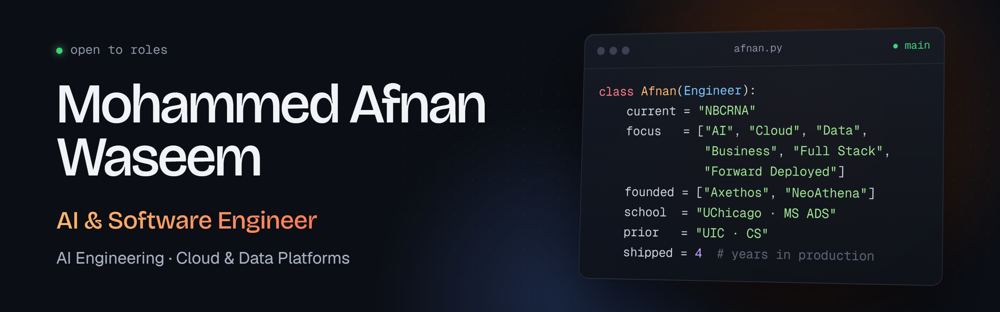

### AI Engineer | LLM Agents, MCP & Evals | Backend, Cloud & Data Platforms | Co-Founder, Axethos | M.S. Applied Data Science, University of Chicago

I build LLM agents and tools the way I build production software: typed interfaces, safety layers, tests, and an eval with a baseline to beat before anything ships.

By day I'm the software engineer at **NBCRNA**, the national certification board for 60,000 nurse anesthetists, where I went from junior developer on an Oracle APEX CRM to architecting the organization's move off on-premises servers: a FastAPI and Next.js platform on Azure, a 400 GB Microsoft Fabric lakehouse, exam cheat-detection models in production on Databricks, and an internal platform used by every staff member. I also introduced Claude Code to the organization and built its MCP servers and PR-review hooks. On my own time I build open-source AI engineering projects (agents, MCP servers, eval-gated CI), co-founded **Axethos**, an AI governance platform, and before it **NeoAthena**, a GenAI content platform. I'm completing an **M.S. in Applied Data Science at the University of Chicago** (4.0 GPA), focused on LLM applications, MLOps, and scalable data systems.

---

## AI engineering projects

Each repo reports real numbers from its own eval runs against a baseline, with tests, CI, a cost note, and a "what didn't work" section.

| Project | What it is | Headline result | Built with |
| --- | --- | --- | --- |
| **[text2sql-agent](https://github.com/mwaseemUC/text2sql-agent)** | Self-correcting text-to-SQL agent: looks up the schema with tools, checks real values with exploratory queries, retries on errors and suspicious results, and self-checks its answer. Runs on a read-only connection with 4 independent write-blocking layers tested against 16 write variants. | On questions where user wording doesn't match stored values, the Haiku agent scores **95% vs 75%** for single-shot Sonnet at about a third of the cost; 100% on the 50-question main set. 364 tests. | LangGraph, Anthropic SDK (prompt caching, strict tools), SQLite, pytest |
| **[sec-edgar-mcp](https://github.com/mwaseemUC/sec-edgar-mcp)** | MCP server giving Claude typed tools over SEC EDGAR: company lookup, filings, annual XBRL financial facts, and 10-K/10-Q sections. Every result carries a source URL; SEC fair-access rules (User-Agent, rate limiter, retries, disk cache) enforced by construction. | **10/10 grounded correct** on a golden set (value right, present in the tool output, cited to the filing) for $0.17 total. Works in Claude Desktop and Claude Code. 277 tests. | MCP Python SDK, httpx, Pydantic, pytest, respx |
| **[pr-review-agent](https://github.com/mwaseemUC/pr-review-agent)** | GitHub Action that reviews each PR with Claude and posts inline comments with severity, bug category, and one-click suggested fixes. Strict tool schema validated by Pydantic, line mapping to commentable lines, dedupe markers, and prompt-injection defenses. | **100% catch rate** on 20 planted-bug PRs across 3 repeats; full-file context lifts precision from 78.9% to 89.2% for +$0.0015 per PR ($0.0086 total). 170 tests. | GitHub Actions, GitHub REST API, Anthropic SDK, Pydantic, pytest |
| **[llm-eval-gate](https://github.com/mwaseemUC/llm-eval-gate)** | LLM support-ticket classifier, a hand-reviewed 50-ticket golden set, and a GitHub Actions gate that fails a PR when accuracy drops more than 3 points against the base branch's baseline. | Blocked a "cost-saving" PR that cut prompt tokens 51% but dropped accuracy **100% to 90%**, and showed the PR saved nothing because of prompt caching. 144 tests. | Anthropic SDK, GitHub Actions, Pydantic, pytest |

---

## Impact at work

**Azure platform architected from scratch**: migrated on-premises Flask services to FastAPI apps on Azure Web Apps (webhooks, public API, internal API, Next.js frontend) handling up to **23K webhook events and 1K API calls per day** for 3 vendor partners, with custom JWT auth, rate limiting, and IAM.

**2,000+ tables, ~400 GB, one lakehouse**: architected a Microsoft Fabric medallion platform migrating Aptify and two exam databases through Data Pipelines, PySpark notebooks, Lakehouses, Warehouses, and Eventhouses for near-real-time Power BI reporting.

**Exam cheat detection, weeks to hours**: productionized collusion-detection models on Azure Databricks that screen **5K-20K exams per quarter** and match an independent psychometric vendor's results **100%**, after tracing and fixing scoring-logic discrepancies in the original pipeline.

**One platform for every staff member**: built an all-in-one Next.js/TypeScript platform used by all ~40 staff that unifies ACGI, Aptify, and exam data through a FastAPI service reading Delta tables directly from OneLake, replacing manual database pulls.

**AI-assisted development, weeks to hours**: introduced Git version control, Fabric Git integration, and Claude Code across the organization (MCP servers, PR-review hooks, CLAUDE.md standards), cutting release cycles from weeks to hours. Primary code reviewer for production deployments and mentor to other developers.

**Member outreach on autopilot**: weekly Twilio SMS and voice campaigns reaching 1K-4K examinees each, a two-way SMS-to-Zendesk channel with opt-out handling, and 2K-6K support tickets per month created and synced automatically.

**150 Azure resources, ~$1.5K/month saved**: administer a hub-and-spoke landing zone (VNets, Key Vault, RBAC/IAM, resource-health alerting) and cut recurring cloud spend.

---

## How I work

| As an engineer | As a builder, founder, and student |
| --- | --- |
| Architect and ship backend, full-stack, and data systems end to end, from API design to deployment | Build LLM agents and MCP tools with evals first: golden sets, baselines, CI regression gates, and cost and latency per call |
| Turn open-ended asks from operations, exam security, and member services into production tools | Treat model output as untrusted: read-only data access, strict tool schemas, Pydantic validation, prompt-injection defenses |
| Integrate vendors through webhooks, public APIs, OAuth 2.0, and event-driven ingestion | Co-founded Axethos: lead product, customer demos, and the core intent-detection system |
| Own the cloud: Azure administration, networking, cost, and monitoring | Co-founded NeoAthena: owned architecture and product, reached 1,000+ users |
| Set Git, CI/CD, code review, and AI-assisted development standards for the team | M.S. Applied Data Science at UChicago (4.0 GPA): RAG, MLOps, Spark, and scalable AI pipelines |

---

## Domains

---

## Stack

**LLMs & Agents**

**Evals, Testing & CI**

**Languages & Frameworks**

**Cloud & Data Platform**

**ML & MLOps**

**Build, Ship & Integrate**

---

## Experience

**Software Developer | NBCRNA** (Jan 2024 - present)
Technical owner for operations, exam security, and member services. Architected the Azure platform, the Fabric lakehouse, and the staff-wide internal platform; productionized cheat detection on Databricks; brought Claude Code and MCP into the team's workflow; administer the Azure environment and lead code review for production releases.

**Junior Software Developer | NBCRNA** (Oct 2022 - Dec 2023)
Built front-end features for ACGI, the organization's Oracle APEX CRM (interactive grids, reports, modal workflows), Python and PL/SQL ETL pipelines into ACGI and reporting tables, and a Python PDF service generating 2,000+ certification applications per month.

**Undergraduate Researcher | Discovery Partners Institute** (Jan - May 2022)
Part of a cross-institution team (UIC, UIUC, IIT, UChicago) analyzing the spread of media misinformation with Python, SQL, and machine learning; presented findings to stakeholders and built a web app to share verified information with the public.

**Teaching Assistant and Grader | University of Illinois Chicago** (2020 - 2021)
Undergraduate TA for computer systems coursework (assembly language, Linux, C++): ran lab sessions and office hours and graded assignments. Also served as a learning assistant and grader for mathematics courses.

---

## Startups

**Axethos | AI governance platform, Co-Founder (2026 - present)**
A platform that sits between employees and AI tools like ChatGPT, Claude, Gemini, and Copilot: it enforces each organization's own AI policy, prevents sensitive data from leaking, and gives leadership visibility into AI usage. Rolls out as a browser extension and desktop app with no network changes. I lead product and built the proprietary intent-detection system (sub-20 ms decisions, self-retraining). Running pilots with early-access partners.

**NeoAthena | GenAI content platform, Co-Founder & Lead Engineer (2023 - 2025)**
A dual-platform GenAI product. The B2C side lets users upload audio and video, get transcripts, chat with their content via RAG, and turn it into articles, blogs, and social posts; the B2B side is an AI-powered event-management system with content tracking, participant registration, and real-time AI chat. Built on Next.js, FastAPI, Supabase, LangChain, and containerized services on AWS (EC2, Lambda, SES, CloudWatch, Route 53). Led a small cross-functional team and reached 1,000+ users through a Raen AI partnership and a 300+ user university pilot.

---

## Coursework and team projects

| Project | What it is | Built with |
| --- | --- | --- |
| **[Multimodal Product Assistant](https://github.com/mwaseemUC/FinalStreamlitApp)** | Text-and-image RAG chatbot over 10,001 Amazon products: answers questions, returns photos, and identifies products from an uploaded picture, with a calibrated confidence gate that declines rather than guesses. 0.965 RAGAS faithfulness, image Recall@5 of 0.751, 0.04 s per image query with no vector database. | CLIP ViT-B/32 + ViT-L/14, MultiQuery, Groq GPT-OSS, Streamlit, Docker |
| **[Diabetes Readmission MLOps Pipeline](https://github.com/enels-uchi/ml-ops-final-group-3)** | End-to-end MLOps on ~70,000 hospital encounters: 7-stage Prefect pipeline, Feast and DVC, AutoML across 16 algorithms with an MLflow champion registry, a Dockerized FastAPI service with in-container Evidently drift detection (~10 ms p95), and Prometheus/Grafana alerting that caught all 4 simulated drift scenarios. Team of 4. | Prefect, Feast, DVC, PyCaret, CatBoost, MLflow, FastAPI, Docker, Evidently, Prometheus, Grafana |
| **[MS-ADS Assistant](https://github.com/mwaseemUC/genAI-midterm)** | RAG chatbot that answers questions about UChicago's MS in Applied Data Science program with cited sources, comparing RAG-Fusion, HyDE, and Multi-Query retrieval under matched conditions. | LangChain, ChromaDB, OpenAI, Streamlit, pytest |
| **[AutoML: PyCaret vs H2O](https://github.com/mwaseemUC/mlops-assignment-3)** | Two AutoML platforms benchmarked on an identical split: cut hold-out RMSE 19.1% versus the linear baseline, with a Champion/Challenger MLflow registry, a portable H2O MOJO export, and a documented reproducibility analysis. | PyCaret, H2O AutoML, MLflow, CatBoost |
| **[Athletes Feature Store Pipeline](https://github.com/mwaseemUC/athletes-mlops-feature-store)** | Reproducible ML pipeline on 423K CrossFit records with versioned feature sets in Feast and tracked experiments; engineered features lifted ROC-AUC from 0.878 to 0.919. | Feast, MLflow on Databricks, scikit-learn |
| **Clinical Intelligence Layer** | UChicago capstone sponsored by Logopedyx: an LLM layer for school-based speech screening that automates clinical documentation, stratifies student risk, and delivers population analytics. In progress. | LLMs, Python |
| **NYC Taxi Analytics on GCP** | BigQuery analytics pipeline over NYC taxi data plus a Streamlit and Gemini app deployed to Cloud Run. | BigQuery, Gemini, Cloud Run, Streamlit |
| **Big Data coursework** | Near-duplicate detection with MinHash LSH in Snowflake, a PySpark air-travel analysis on Databricks, and containerized workloads on GCP. | Snowflake, Databricks, PySpark, Docker |

### Earlier work

**NuNote**: a mobile note app that clusters notes by topic and auto-generates tags, with semantic retrieval over a RAG pipeline (FastAPI, Java, Android Studio, Firebase, PostgreSQL).

**Stack Overflow trend analysis**: mined 2008-2022 Stack Overflow activity to identify shifts in user engagement and proposed platform optimizations from the findings.

**Spam email classifier**: preprocessed the Spambase dataset and compared multiple classification algorithms to build an accurate spam filter in Python.

**Stock & crypto advisor app** (team project): Android app giving personalized stock and crypto recommendations from user preferences and live market data (Java, Firebase, Yahoo Finance API).

---

## Education

**M.S., Applied Data Science, University of Chicago** (4.0 GPA, expected March 2027)
Generative AI · MLOps · Scalable Data Systems & AI Pipelines · Big Data & Cloud Computing

**B.S., Computer Science, University of Illinois Chicago** (2022)

---

## Community & speaking

**ASAE Technology Professionals Advisory Council** (2025 - present), previously **ASAE NextGen Council** (2024 - 2025), focused on how associations adopt AI and modern technology.

Selected speaking: *Association Tech Insider* podcast, "Introduction to RAG" (2025) · DelCor panel on the future of technology skills and professional development (2024).

Winner, **Singularity University Global Innovation Challenge** (2016).

---

Production software by day, measured AI agents by night, and always the one who ships it.
